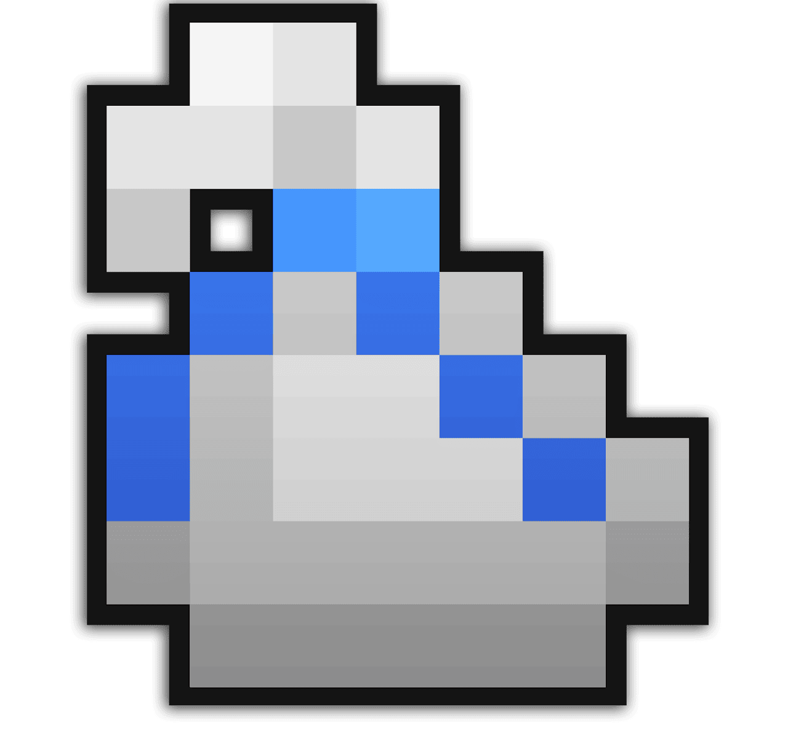

Source: https://sites.google.com/decagames.com/xml-documentation/getting-started/design-basics

# Design basics

The main purpose of this website is to teach you XML for Realm of the Mad God.

However, a great Boss or Monster is not only made of code: i**t also requires a good and detailed design idea!**

Before you jump into scripting, you should think about it and lay down the concept of the Monster you want to create. This will help you break down the work into pieces such as phases, transitions, attacks, movement, difficulty and feeling for the Monster and get a better overview of how you should structure your code.

## Monster design \- questions you should answer before you start:

- **What is your Monster's name?**
- **What is its story?**
- **How will it look like? Do you already have a concept art or sprite?**
- **What actions will it perform?**
  - *How does the Monster behave? Does it follow specific phases during combat?*
  - *How does the Monster shoot? How many different attacks does it do?*
  - *What condition effects does it inflict to Players? Does it inflict any condition effect to itself?*
  - *Is it resistant to specific player effects?*
- **How does it move?**
  - *How quickly does it move? How far will it chase?*
  - *How aggressive should it be? Is it keeping its distance with players or charging head first?*
- **Is it a group of Monsters who behave as a horde? Is it going to be only one entity?**
  - *Does this monster create minions? Is this monster a minion? Is it neither?*

*Check out this complete [**Dungeon Template**](../dungeon-template.txt) to create great concepts! (Credits: Sues)*

### [Next: Tutorial \- Your first Monster! \>](tutorial-your-first-monster.md)

[**Leave feedback**](../feedback.md)

Is something described here not clear or do you have ideas on how to improve the documentation? Let us know!
