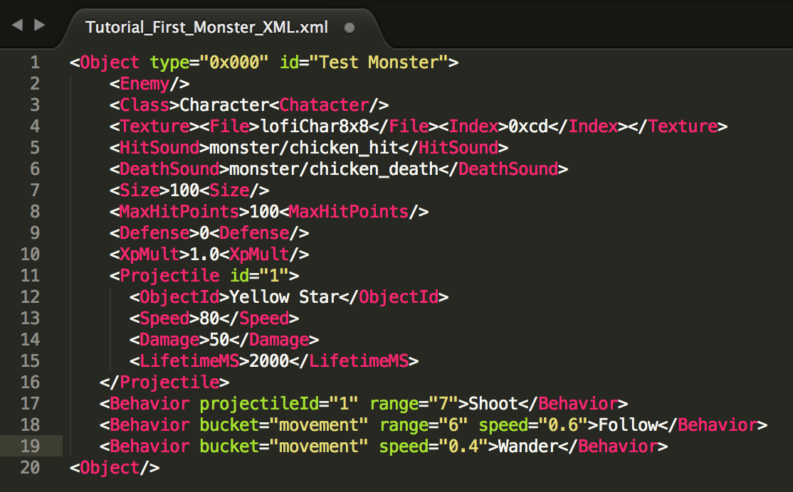
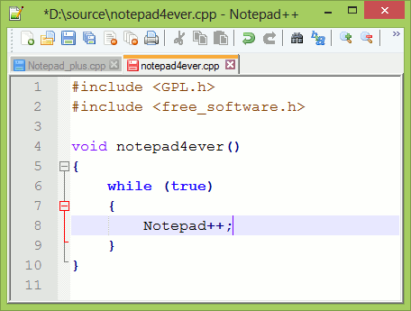

Source: https://sites.google.com/decagames.com/xml-documentation/getting-started/tools

# Tools

**A text editor** \- you can use any of the many free text editors available on the internet.

We recommend:

- [***Sublime Text 3***](https://www.sublimetext.com/)*, a sophisticated text editor for code.*
- [***Notepad\+\+***](https://notepad-plus-plus.org/), *a good alternative.*
- [***Brackets.io***](http://brackets.io)*, an open source text editor.*

**XML validation** \- a quick way to proof read your code syntax. You can either copy/paste the code or upload your XML files directly.

- [**http://xmlvalidation.com/**](http://xmlvalidation.com/)

### [Next: Design basics \>](design-basics.md)

[**Leave feedback**](../feedback.md)

Is something described here not clear or do you have ideas on how to improve the documentation? Let us know!
