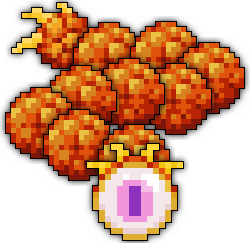
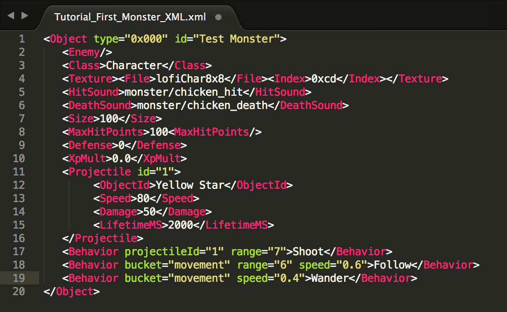

Source: https://sites.google.com/decagames.com/xml-documentation/getting-started/tutorial-your-first-monster

# Tutorial \- Your first Monster step-by-step!

In this section, we are going to create a simple Monster step-by-step.

All you need is to have your [***Text Editor***](tools.md) open and follow the steps below:



## Step 0 \- Create a new XML file

Open your [Text Editor](tools.md) and Create a new file.

Hit the "Save as" option and save your file as "**Tutorial\_First\_Monster\_XML.xml**".

By saving the file in .xml, your Editor should recognize the language and apply the appropriate color coding to your script!

## Step 1 \- Create the Monster Object

```
<Object type="0x000" id="Test Monster">
```

```
   <DisplayId>Oryx the Mad God</DisplayId>
```

```
</Object>
```

You have now created a new Object called "Test Monster" and assigned a type to it.

We have also created a \<DisplayId\> which is the name that players will see, whereas in the code the monster Id is "Test Monster".

***NOTE:** As you can in the above syntax, we have opened `<Object>` and closed `</Object>`. We also did the same with `<DisplayId>` and `</DisplayId>`. You must **ALWAYS** close your tags after opening them or your XML will not work.*

***NOTE 2:** both the `type` and `id` need to be unique and the `id` needs to be easily **id**entifiable, but that is not important for our tutorial. So don't worry about that just yet!*

## Step 2 \- Add basic properties

```
<Object type="0x000" id="Test Monster">
```

```
   <DisplayId>Oryx the Mad God</DisplayId>
```

```
   <Enemy/>
```

```
   <Class>Character</Class>
```

```
   <Texture><File>lofiChar8x8</File><Index>0xcd</Index></Texture>
```

```
   <HitSound>monster/chicken_hit</HitSound>
```

```
   <DeathSound>monster/chicken_death</DeathSound>
```

```
</Object>
```

```

```

You now defined:

- That the Monster is an enemy and can be damaged by players (`<Enemy/>`).
- The sprite that will be used for the Monster, by indicating the Spritesheet file and the Sprite index on that sheet.
- The [Sounds](../misc/list-of-sounds.md) played by the Monster when it gets hit by players (`<HitSound>)` and when it dies (`<DeathSound>`).

## Step 3 \- Add Monster's attributes

```
<Object type="0x000" id="Test Monster">
```

```
   <DisplayId>Oryx the Mad God</DisplayId>
```

```
   <Enemy/>
```

```
   <Class>Character</Class>
```

```
   <Texture><File>lofiChar8x8</File><Index>0xcd</Index></Texture>
```

```
   <HitSound>monster/chicken_hit</HitSound>
```

```
   <DeathSound>monster/chicken_death</DeathSound>
```

```
   <Size>100</Size>
```

```
   <MaxHitPoints>100</MaxHitPoints>
```

```
   <Defense>0</Defense>
```

```
   <XpMult>0.0</XpMult>
```

```
</Object>
```

```

```

You now defined:

- The Size of the Monster in percentage (player characters are rendered at 100, items at 80 and starter pets at 60).
- The Monster's hit points, which defines how much damage the Monster will take before dying.
- The Monster's Defense, which defines how much of the player's damage is absorbed.
- The XP that a monster grants upon death is defined by its HP and multiplied by the `<XpMult>` value. If set to 0.0, our current Test Monster would grant 0XP, 1.0 would grant 100XP and 2.0 would grant 200XP (etc...).

## Step 4 \- Add a new projectile type to the Monster

```
<Projectile id="1">
```

```

```

```
</Projectile>
```

The projectile ID will be used only by this monster, so you can add projectiles "1", "2" and "3" to as many Monsters as you want. However, to be able to identify what projectile is what, it is better to define better IDs (like "Shotgun bullet" or "Slow bullet").

```
<Projectile id="1">
```

```
   <ObjectId>Yellow Star</ObjectId>
```

```
   <Speed>80</Speed>
```

```
   <Damage>50</Damage>
```

```
   <LifetimeMS>2000</LifetimeMS>
```

```
</Projectile>
```

You now added the projectile properties:

- ObjectID: the projectile's Object ID \- [the projectile is an Object and needs to be created separately](../xml-guide/projectiles.md)
- Speed: the projectile's velocity
- Damage: the projectile's damage
- LifetimeMS: the projectile's lifetime in milliseconds, before it disappears.

Now, integrate that projectile into the XML:

```
<Object type="0x000" id="Test Monster">
```

```
   <DisplayId>Oryx the Mad God</DisplayId>
```

```
   <Enemy/>
```

```
   <Class>Character</Class>
```

```
   <Texture><File>lofiChar8x8</File><Index>0xcd</Index></Texture>
```

```
   <HitSound>monster/chicken_hit</HitSound>
```

```
   <DeathSound>monster/chicken_death</DeathSound>
```

```
   <Size>100</Size>
```

```
   <MaxHitPoints>100</MaxHitPoints>
```

```
   <Defense>0</Defense>
```

```
   <XpMult>0.0</XpMult>
```

```
   <Projectile id="1">
```

```
      <ObjectId>Yellow Star</ObjectId>
```

```
      <Speed>80</Speed>
```

```
      <Damage>50</Damage>
```

```
      <LifetimeMS>2000</LifetimeMS>
```

```
   </Projectile>
```

```
</Object>
```

Our Monster is now created, has basic properties and attributes and also has one projectile type.

Now we need to make it move and shoot!

## Step 5 \- Add basic Movement and Shooting behavior to the Monster

```
   <Behavior projectileId="1" range="7">Shoot</Behavior>
```

```
   <Behavior bucket="movement" range="6" speed="0.6">Follow</Behavior>
```

```
   <Behavior bucket="movement" speed="0.4">Wander</Behavior>
```

Make the Monster shoot:

```
<Behavior projectileId="1" range="7">Shoot</Behavior>
```

We have created our first behavior: the monster will [***Shoot***](../behaviors-transitions-list/shoot.md) our projectile (based on the id we defined earlier) when a player enters a range of 7 tiles.

Make the Monster move:

```
<Behavior bucket="movement" range="6" speed="0.6">Follow</Behavior>
```

```
<Behavior bucket="movement" speed="0.4">Wander</Behavior>
```

We have created our first two movement behaviors:

- the Monster will follow any player that is in a radius of 6 tiles or less at a speed of 0.6
- if no player is in range of the "[Follow](../behaviors-transitions-list/follow.md)" behavior, the monster will "[Wander](../behaviors-transitions-list/wander.md)" at a speed of 0.4

Let's integrate that into our XML:

```
<Object type="0x000" id="Test Monster">
```

```
   <DisplayId>Oryx the Mad God</DisplayId>
```

```
   <Enemy/>
```

```
   <Class>Character</Class>
```

```
   <Texture><File>lofiChar8x8</File><Index>0xcd</Index></Texture>
```

```
   <HitSound>monster/chicken_hit</HitSound>
```

```
   <DeathSound>monster/chicken_death</DeathSound>
```

```
   <Size>100</Size>
```

```
   <MaxHitPoints>100</MaxHitPoints>
```

```
   <Defense>0</Defense>
```

```
   <XpMult>0.0</XpMult>
```

```
   <Projectile id="1">
```

```
      <ObjectId>Yellow Star</ObjectId>
```

```
      <Speed>80</Speed>
```

```
      <Damage>50</Damage>
```

```
      <LifetimeMS>2000</LifetimeMS>
```

```
   </Projectile>
```

```
   <Behavior projectileId="1" range="7">Shoot</Behavior>
```

```
   <Behavior bucket="movement" range="6" speed="0.6">Follow</Behavior>
```

```
   <Behavior bucket="movement" speed="0.4">Wander</Behavior>
```

```
</Object>
```

### CONGRATULATIONS! You've created a monster for Realm of the Mad god.

It has attributes such as life and defense, it moves and it shoots. More importantly, players can destroy it!

The next sections of this website will go more in depths on how to create the complex monsters that populate the Realm of the Mad God.



### [Next: XML Guide](../xml-guide.md) \>

[**Leave feedback**](../feedback.md)

Is something described here not clear or do you have ideas on how to improve the documentation? Let us know!
