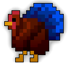

Source: https://sites.google.com/decagames.com/xml-documentation/xml-guide

# XML Guide

In this part, you will find every detail on how to code XML to create monsters for Realm of the Mad God.

We will dive straight into the topic with our first example, the Test Chicken, and explain each of the fields one by one.



### The Test Chicken Example

```
<Object type="0x023b" id="Test Chicken">
```

```
 <Group>Test Chickens</Group>
```

```
 <Enemy/>
```

```
 <Class>Character</Class>
```

```
 <Texture><File>lofiChar8x8</File><Index>0xcd</Index></Texture>
```

```
 <HitSound>monster/chicken_hit</HitSound>
```

```
 <DeathSound>monster/chicken_death</DeathSound>
```

```
 <MaxHitPoints>100</MaxHitPoints>
```

```
 <Projectile id="0">
```

```
   <ObjectId>Cyan Magic</ObjectId>
```

```
   <Speed>120</Speed>
```

```
   <Damage>1</Damage>
```

```
   <LifetimeMS>2000</LifetimeMS>
```

```
 </Projectile>
```

```
 <Projectile id="1">
```

```
   <ObjectId>Green Star</ObjectId>
```

```
   <Speed>80</Speed>
```

```
   <Damage>1</Damage>
```

```
   <ConditionEffect duration="3">Slowed</ConditionEffect>
```

```
  <LifetimeMS>2000</LifetimeMS>
```

```
 </Projectile>
```

```
 <Size>100</Size>
```

```
 <Defense>0</Defense>
```

```
 <XpMult>0.0</XpMult>
```

```
 <State id="Attacking">
```

```
   <State id="Bullet1">
```

```
     <Behavior numShots="3" projectileId="0"cooldown="0.6">Shoot</Behavior>
```

```
     <Transition afterTime="1.2">Wait1</Transition>
```

```
   </State>
```

```
   <State id="Wait1">
```

```
     <Transition afterTime="1">Bullet2</Transition>
```

```
   </State>
```

```
   <State id="Bullet2">
```

```
     <Behavior projectileId="1" cooldown="10.0">Shoot</Behavior>
```

```
     <Transition afterTime="1.0">Bullet1</Transition>
```

```
   </State>
```

```
   <Behavior>Follow</Behavior>
```

```
   <Transition hitpointsLessThan="0.5">Flash</Transition>
```

```
 </State>
```

```
 <State id="Flash">
```

```
   <Behavior type="Flash" color="FF0000">ShowEffect</Behavior>
```

```
   <Transition afterTime="1.0">Explode</Transition>
```

```
 </State>
```

```
 <State id="Explode">
```

```
   <Behavior range="0.0" projectileId="0">Explode</Behavior>
```

```
 </State>
```

```
 <Behavior>Taunt</Behavior>
```

```
</Object>
```

```

```

### Here is what each field means:

```
<Object type="0x023b" id="Test Chicken">
```

This creates the concept of an object. The “type” and “id” fields must be unique. For testing purposes, use the 0x7FXX space for types and use whatever ids you want.

```
<Group>Test Chickens</Group>
```

```

```

Specifies the group this object belongs to. This is used by some [behaviors](behaviors-transitions-list.md).

```
<Enemy/>
```

This specifies that the object can take damage from players.

```
<Class>Character</Class>
```

This is used internally.

```
<Texture><File>lofiChar8x8</File><Index>0xcd</Index></Texture>
```

This specifies the texture file to use. This refers to a spritesheet embedded in the SWF. The index can be either hexadecimal or decimal and determines where in the sheet the sprite is (counts starting at 0).

Counting in hex: 0 1 2 3 4 5 6 7 8 9 a b c d e f

For \<Texture\> it is recommended to use hexadecimals, as object sheets are arranged to have 16 items per row. Meaning 0x10 would point to the first item of the second row, 0x0f would point to the last item of the first row.

When using animated sprite sheets, \<AnimatedTexture\> needs to be used instead of \<Texture\> to prevent client errors.

For \<AnimatedTexture\> it is recommended to use decimals as it is easier to count and the index will only determine the row used.

Sounds:

```
<HitSound>monster/chicken_hit</HitSound>
```

```
<DeathSound>monster/chicken_death</DeathSound>
```

Specifies the hit/death sounds for the monster. These tags can be left out and it will use the default sounds. See list at end for all available sounds.

```
<MaxHitPoints>100</MaxHitPoints>
```

Specifies the hit points of the monster.

```
<Projectile id="0">
```

Specifies a type of projectile that monster can shoot. The “id” must be a number less than 256\. The following are included inside Projectile tag.

```
<ObjectId>Cyan Magic</ObjectId>
```

Specifies the appearance of the projectile.

```
<Speed>120</Speed>
```

Specifies the speed of the projectile.

```
<Damage>1</Damage>
```

Specifies the hitpoints lost by the player if hit by the projectile.

```
<LifetimeMS>2000</LifetimeMS>
```

This specifies how long the projectile lasts in milliseconds.

```
<ConditionEffect duration="3">Slowed</ConditionEffect>
```

This specifies the condition effect that the player will get if hit by the projectile.

A list of all condition effects can be found at the end of this document.

Other tags that can be included in the Projectile tag:

```
<MinDamage>10</MinDamage>
```

```
<MaxDamage>20</MaxDamage>
```

This projectile will do a random amount of damage between the two values.

```
<MultiHit/>
```

This projectile will not stop when it hits a player; it can hit every player at most once.

```
<PassesCover/>
```

This projectile will not stop when it hits a tree, rock, etc. It will stop when it hits a wall.

```
<ArmorPiercing/>
```

This projectile will ignore the player or enemy's defense when calculating damage done.

```
<Wavy/>
```

```
<Parametric/>
```

```
<Boomerang/>
```

These give the projectile non-straight trajectories. Don’t include more than one.

```
<Amplitude>0.6</Amplitude>
```

```
<Frequency>2.0</Frequency>
```

These modify the trajectory of the bullet to make it follow a wave path. This is compatible with the default and Boomerang projectiles. By default, Amplitude is 0 and Frequency is 1\. Frequency is in units of cycles per lifetime.

```
<Size>100</Size>
```

This specifies the size of the object as a percentage. The value 100 means that one pixel in the bitmap maps to 5 on the screen so multiples of 20 render well (but it is not required). Examples: player characters are rendered at 100, items at 80 and starter pets at 60\.

```
<Defense>0</Defense>
```

This specifies how much damage from player projectiles is absorbed.

```
<XpMult>0.0</XpMult>
```

The amount of xp the player gets from killing a creature is determined by its hitpoints. This modifies that amount by multiplying it by the factor stated.

States, behaviors, transitions and orders will be described below. Before that, here are some other tags that can be in the Object tag. Enemies that you want to have live in the Realm, need a few extra tags:

```
<Terrain>MidSand</Terrain>
```

This determines where the creature lives and is used to keep the correct counts of monsters in each terrain.

```
<SpawnProb>1.0</SpawnProb>
```

This determines the probability of this monster spawning in the Realm. It defaults to 0 (i.e. does not spawn in the Realm). A probability of 1.0 means that it will be considered for spawning every time a creature is needed in this creature’s terrain, 0.5 means it will be considered half of the time.

```
<Spawn><Mean>5</Mean><StdDev>2</StdDev><Min>3</Min><Max>10</Max></Spawn>
```

This tag determines the number of these enemies that will appear when it is spawned. The default is a single enemy but you can use the Spawn tag to create a group. It uses a Normal distribution with mean, standard deviation, min and max specified.

```
<StasisImmune/>
```

This creature can not be stasis-ed.

```
<God/>
```

This creature counts as a “god” for the purposes of counting God kills.

```
<Cube/>
```

This creature counts as a “cube” for the purposes of counting Cube kills.

```
<Oryx/>
```

This creature counts as “Oryx” for the purposes of counting Oryx kills.

```
<DisplayId>Test Chicken</DisplayId>
```

Sometimes it is useful to use a non-unique for an object. This overrides the objects “id” for the purpose of displaying the text to the player.

```
<Z>0.3</Z>
```

This will cause an object to be drawn 0.3 squares above the ground. This is useful for making objects look like they are flying.

```
<AltTexture id="1">
```

```
    <Texture><File>lofiChar28x8</File><Index>0x91</Index></Texture>
```

```
</AltTexture>
```

This will specify an alternative texture that can be used by the creature at certain times. The id must be an integer greater than 0\. See the “SetAltTexture” behavior for how to use this.

For more simple animation cycles that work on static objects as well, use the “Animation” tag. An example is below:

```
<Animation prob="1.0" period="10.0">
```

```
    <Frame time="0.5">
```

```
        <Texture><File>lofiEnvironment</File><Index>0x4a</Index></Texture>
```

```
    </Frame>
```

```
</Animation>
```

```
<Animation prob="0.2" period="2.0" periodJitter="1.0">
```

```
    <Frame time="0.5">
```

```
        <Texture><File>lofiEnvironment</File><Index>0x4b</Index></Texture>
```

```
    </Frame>
```

```
    <Frame time="0.5">
```

```
        <Texture><File>lofiEnvironment</File><Index>0x4c</Index></Texture>
```

```
    </Frame>
```

```
</Animation>
```

An object with these tags has two animations. The first plays every ten seconds (period\=”10.0”) every time (prob\=”1.0”). This first animation has single frame that lasts for half a second (time\=”0.5”).

The second animation happens between every 1.0 and 3.0 seconds (period\="2.0" periodJitter\="1.0") with a 20% chance (prob\="0.2"). It has two frames that each last half a second and are played sequentially.

In animations, the “\<Texture\>” can be a RemoteTexture, RandomTexture, etc.

Another example:

```
<Animation sync="true" period="10.0">
```

```
    <Frame time="0.5">
```

```
        <Texture><File>lofiEnvironment</File><Index>0x4a</Index></Texture>
```

```
    </Frame>
```

```
</Animation>
```

This is a “sync” animation which means it will be synchoronized with any other animations that have the same period. In this case, “periodJitter” is ignored and “prob” will be calculated independently for each object.

Also, instead of an \<Object … \> tag, you can include separate URLs thus:

```
<Include>https://dl.dropbox.com/s/vkkrsm9esuaunpo/includeTestXML.txt</Include>
```

This will have the server download and parse the contents of the named URL.

```
<ShadowSize>50</ShadowSize>
```

```
<ShadowColor>0xFF0000</ShadowColor>
```

These tags allow you to modify the size and color of the object’s shadow.

### [Next: Behaviors and Buckets \>](xml-guide/behaviors-and-buckets.md)

[**Leave feedback**](feedback.md)

Is something described here not clear or do you have ideas on how to improve the documentation? Let us know!
